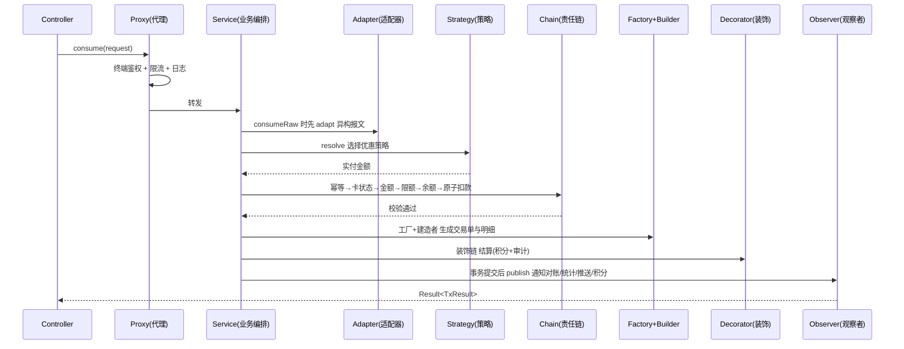

# 校园一卡通消费与结算系统

> Campus One-Card consumption & settlement system — a Spring Boot + Vue 3 demo that showcases **9 GoF design patterns** in a real business flow.
>
> 软件设计模式课程项目 · 技术栈：**Java 8 + Spring Boot 2.7.18 + Vue 3 (Vite) + MySQL 8.0 + Maven**


---

## 一、项目简介

系统面向校园内食堂 POS、超市收银、门禁、水控等消费终端，实现开户 / 挂失 / 充值 / 销户、优惠扣款、
退款冲正、交易明细查询、按终端对账统计，以及交易完成后的消息通知。

工程采用**分层架构**（表示层 Controller → 业务层 Service → 数据访问层 DAO），
并在业务层组合应用 **9 种设计模式**来隔离变化点、降低耦合。每个模式按包独立存放，并配有 `package-info.java` 说明。

### 使用的设计模式

| # | 模式 | 类型 | 关键类（`src/main/java/com/campus/card/pattern/`） | 解决的变化点 |
| --- | --- | --- | --- | --- |
| 1 | 工厂模式 | 创建型 | `factory/TransactionFactory` + `TransactionHandler`（充值/消费/退款） | 交易类型扩展 |
| 2 | 建造者模式 | 创建型 | `builder/TransactionBuilder` | 交易单字段多、明细可选 |
| 3 | 策略模式 | 行为型 | `strategy/DeductStrategy` + 4 策略 + `DeductStrategyResolver` | 优惠算法切换 |
| 4 | 责任链模式 | 行为型 | `chain/ValidateHandler` + 6 处理器 + `ValidationChain` | 校验步骤增删/排序 |
| 5 | 观察者模式 | 行为型 | `observer/TransactionSubject` + 4 观察者 + `TransactionEventPublisher` | 交易后下游扩展 |
| 6 | 单例模式 | 创建型 | `config/SystemConfig`、`config/IdempotencyCache` | 全局配置/幂等缓存唯一实例 |
| 7 | 适配器模式 | 结构型 | `adapter/TerminalAdapter` + 4 适配器 + `TerminalAdapterRegistry` | 异构终端报文 |
| 8 | 代理模式 | 结构型 | `proxy/ServiceInvocationHandler`（JDK 动态代理） | 鉴权/限流/日志横切 |
| 9 | 装饰模式 | 结构型 | `decorator/SettlementFacade` + 3 层装饰 | 结算功能动态叠加 |

### 一次消费的协作主线



> 业务编排类 `TransactionServiceImpl` **不含任何算法分支**，所有变化点都委托给上述模式；
> 新增一类交易、一种优惠、一道校验或一条结算增强，都不需要改动主流程（开闭原则）。

更完整的模式说明、类图与时序图见 [`docs/设计模式说明.md`](docs/设计模式说明.md)。

---

## 二、目录结构

```
campus-card/
├── pom.xml                        Maven 构建文件（Java 8）
├── README.md                      本文件
├── LICENSE                        MIT 许可证
├── .gitignore                     忽略构建产物 / 依赖 / IDE 配置
├── 界面预览.html                   免构建的 Vue 3 界面预览（双击可看）
├── sql/
│   └── init.sql                   首次建库 + 建表 + 初始数据
├── src/main/resources/
│   ├── application.yml            数据源与业务参数配置
│   ├── schema.sql                 应用启动时自动建表（IF NOT EXISTS）
│   └── data.sql                   演示数据（INSERT IGNORE，可重复启动）
├── src/main/java/com/campus/card/
│   ├── common/                    统一响应、错误码、异常与全局处理
│   ├── config/                    单例配置、幂等缓存、Bean 装配、跨域
│   ├── entity/ dto/               实体与数据传输对象
│   ├── dao/                       数据访问层（JdbcTemplate + RowMapper）
│   ├── pattern/                   九种设计模式实现（按模式分包，含 package-info）
│   ├── service/                   业务层接口与实现（事务边界）
│   ├── controller/                表示层 REST 接口
│   └── util/                      流水号、金额、积分工具
├── src/test/java/                 JUnit 5 单元测试（模式有效性 + 并发）
├── frontend/                      Vue 3 + Vite 前端工程
├── docs/                          接口 / 数据库 / 设计模式 / 部署 / 测试文档
└── scripts/                       接口与并发复现脚本（Python 标准库）
```

---

## 三、快速启动

**环境要求**：JDK 8、Maven 3.6+、MySQL 8.0、Node.js 18+（含 npm）。

```bash
# 1) 初始化数据库（创建 campus_card 库、8 张表及演示数据）
#    Windows 必须带 --default-character-set=utf8mb4，否则中文姓名会乱码
mysql -uroot -p --default-character-set=utf8mb4 < sql/init.sql

# 2) 按需修改数据库连接（默认 root/123456，以 application.yml 为准）
#    src/main/resources/application.yml

# 3) 启动后端（端口 8080）
mvn spring-boot:run
#   或：mvn clean package -DskipTests && java -jar target/campus-card-1.0.0.jar

# 4) 启动前端（另开终端，端口 5173，已配置 /api 代理）
cd frontend
npm install
npm run dev

# 5) 浏览器打开 http://localhost:5173
```

若不方便安装 Node，可直接双击 `界面预览.html` 查看界面布局与交互演示（Vue 3 CDN，需联网）。
更详细的 IDE / 多环境部署说明见 [`docs/本地部署指南.md`](docs/本地部署指南.md)。

---

## 四、演示数据

| 卡号 | 持卡人 | 卡类型 | 状态 | 初始余额 | 交易密码 |
| --- | --- | --- | --- | --- | --- |
| 202601010001 | 张同学 | STUDENT | NORMAL | 500.00 | 123456 |
| 202601010002 | 李同学 | STUDENT | NORMAL | 150.00 | 123456 |
| 202601010003 | 王同学 | STUDENT | LOST | 20.00 | 123456 |
| T20260001 | 赵老师 | TEACHER | NORMAL | 1000.00 | 888888 |

终端：`POS-01`、`POS-02`（食堂）、`MART-01`（超市）、`ACCESS-01`（门禁）、`WATER-01`（水控）。

**一个最短验证流程**：启动后端 → `POST /api/transactions/consume` 提交
`{"cardNo":"202601010001","terminalNo":"POS-01","terminalType":"POS","amount":15.00,"pin":"123456","idempotencyKey":"DEMO-001"}`，
预期返回 `actualAmount=13.50`（学生 9 折）或午餐时段 `13.00`（2 元补贴），
随后 `GET /api/transactions` 可查到流水，`GET /api/notifications` 可看到观察者产生的通知。

除上表 4 张基础卡外，`sql/init.sql` 与 `src/main/resources/data.sql` 还预置了一批历史数据，
打开 Dashboard、交易明细、通知、对账页面时不必先手工造数据（扩展卡片 6 张、扩展终端 3 个、历史交易 28 笔等）。
全部使用 `INSERT IGNORE` + 显式 id（≥100），重复启动不覆盖已有数据；交易时间写成相对日期，始终落在「近 30 日」窗口内。
数据自检：`python scripts/check_demo_data.py`（只读接口，11 项检查）。

---

## 五、接口速查

完整请求/响应示例见 [`docs/API接口设计.md`](docs/API接口设计.md)。

| 方法 | 路径 | 说明 |
| --- | --- | --- |
| POST | `/api/cards?balance=0` | 开户 |
| GET | `/api/cards`、`/api/cards/{cardNo}` | 卡片列表 / 状态查询 |
| PUT | `/api/cards/{cardNo}/lost` | 挂失 |
| DELETE | `/api/cards/{cardNo}` | 销户（余额必须为 0） |
| POST | `/api/cards/{cardNo}/recharge` | 充值 |
| POST | `/api/transactions/consume` | 标准消费扣款 |
| POST | `/api/transactions/consume/raw` | 异构终端原始报文消费（适配器） |
| POST | `/api/transactions/refund` | 退款 / 冲正 |
| GET | `/api/transactions` | 消费明细分页查询 |
| GET | `/api/statistics/summary` | 分类统计 |
| GET | `/api/notifications` | 通知与审计日志 |
| POST | `/api/reconcile/settle` | 按终端对账 |
| GET | `/api/reconcile/records` | 对账记录 |
| GET | `/api/terminals` | 终端列表 |

---

## 六、文档导航

| 文档 | 内容 |
| --- | --- |
| [`docs/API接口设计.md`](docs/API接口设计.md) | 全部 REST 接口的请求/响应示例与字段说明 |
| [`docs/数据库设计.md`](docs/数据库设计.md) | 8 张表结构、状态枚举、乐观锁与索引设计 |
| [`docs/设计模式说明.md`](docs/设计模式说明.md) | 9 种模式的职责、协作时序图与代码落点 |
| [`docs/本地部署指南.md`](docs/本地部署指南.md) | IDEA / VS Code / 命令行 部署与排错 |
| [`docs/测试与复现.md`](docs/测试与复现.md) | 单元测试与接口/并发脚本复现说明 |

---

## 七、测试与复现

```bash
mvn test          # 9 个 JUnit 5 用例：7 个设计模式 + 2 个并发
npm run build     # 前端构建
```

接口级测试是对运行中的后端发真实 HTTP 请求完成的，复现脚本见 `scripts/`：

```bash
export CAMPUS_BASE=http://localhost:8080
python scripts/run_api_tests.py          # 32 条功能 / 边界 / 异常用例
python scripts/run_concurrency_tests.py  # 100 线程并发 + 200 请求混合负载（会真实扣款，请在临时库上跑）
python scripts/check_demo_data.py        # 演示数据自检
```

详细的测试设计与复现步骤见 [`docs/测试与复现.md`](docs/测试与复现.md)。

---

## 八、常见问题

- **启动报数据库连接失败**：确认 MySQL 已启动、`campus_card` 库已创建、`application.yml` 账号密码正确。
- **端口占用**：修改 `server.port` 与 `frontend/vite.config.js` 的 proxy 目标端口。
- **重复消费提示 1007**：同一 `idempotencyKey` 只能成功一次，换新键再提交即可。
- **余额不足提示 1005**：先调用充值接口，或换用余额充足的演示卡。
- **前端报跨域**：请通过 `npm run dev` 访问，Vite 已配置代理；不要直接用 `file://` 打开前端源码。

---

## 九、许可证与贡献

- 本项目以 **MIT 许可证** 开源，详见 [`LICENSE`](LICENSE)。
- 欢迎提交 Issue 与 Pull Request。提交前请运行 `mvn test` 与 `npm run build` 确保通过；
  演示数据调整请通过 `scripts/generate_test_data.py` 生成，避免手工改动 SQL。

---

## 十、开发说明（透明度记录）

本项目为软件设计模式课程作品，如实记录：
实体类 getter/setter、DAO 样板 SQL、前端表单骨架等重复代码，以及文档初稿借助工具打底；
稳定点/变化点划分、九种模式的选型与协作、类图与代码逐处对齐、并发扣款方案，以及开发过程中的返工与实测，均为人工判断、调试并复核。
辅助生成的部分在使用前均经过人工改写和编译/运行验证，没有直接照搬。
