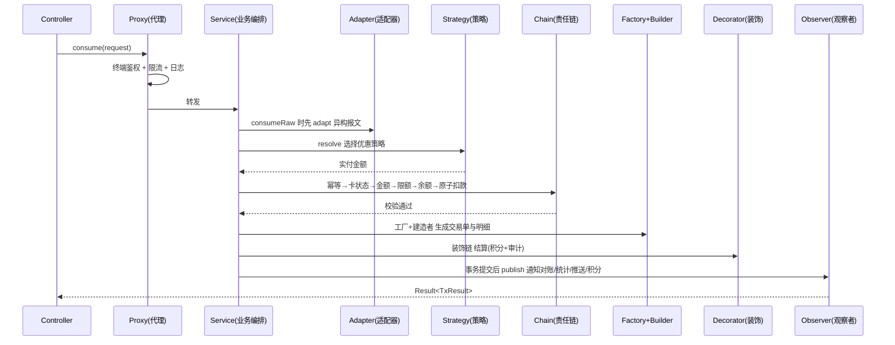

# 设计模式说明

本项目是一个**软件设计模式**教学演示系统，业务层围绕「校园一卡通消费与结算」组合应用了 **9 种 GoF 设计模式**，
目的是隔离变化点、降低耦合、让扩展对主流程透明。每个模式都按包独立存放于
`src/main/java/com/campus/card/pattern/`（各包均有 `package-info.java` 说明）。

## 模式一览

| # | 模式 | 类型 | 关键类 | 解决的变化点 |
| --- | --- | --- | --- | --- |
| 1 | 工厂模式 | 创建型 | `factory/TransactionFactory` + `TransactionHandler`（Recharge/Consume/Refund） | 交易类型扩展 |
| 2 | 建造者模式 | 创建型 | `builder/TransactionBuilder` | 交易单字段多、明细可选 |
| 3 | 策略模式 | 行为型 | `strategy/DeductStrategy` + 4 策略 + `DeductStrategyResolver` | 优惠算法切换 |
| 4 | 责任链模式 | 行为型 | `chain/ValidateHandler` + 6 处理器 + `ValidationChain` | 校验步骤增删/排序 |
| 5 | 观察者模式 | 行为型 | `observer/TransactionSubject` + 4 观察者 + `TransactionEventPublisher` | 交易后下游扩展 |
| 6 | 单例模式 | 创建型 | `config/SystemConfig`、`config/IdempotencyCache` | 全局配置/幂等缓存唯一实例 |
| 7 | 适配器模式 | 结构型 | `adapter/TerminalAdapter` + 4 适配器 + `TerminalAdapterRegistry` | 异构终端报文 |
| 8 | 代理模式 | 结构型 | `proxy/ServiceInvocationHandler`（JDK 动态代理） | 鉴权/限流/日志横切 |
| 9 | 装饰模式 | 结构型 | `decorator/SettlementFacade` + 3 层装饰 | 结算功能动态叠加 |

## 一次消费的协作主线

> 关键点：**业务编排类 `TransactionServiceImpl` 不含任何算法分支**，所有变化点都委托给上述模式，
> 因此新增一类交易、一种优惠、一道校验或一条结算增强，都不需要改动主流程（开闭原则）。

## 各模式要点

- **策略模式**：`DeductStrategy.calculate(ctx)` 返回实付金额；`DeductStrategyResolver` 集中决策
  （显式指定 > 午餐时段学生补贴 > 师生折扣 > 原价），消除 `if/else` 叠加。
- **责任链模式**：`ValidateHandler` 用模板方法固定「先校验自己、失败短路、否则交下一级」，
  末端的 `DeductHandler` 在事务内执行乐观锁原子扣款，保证并发安全。
- **观察者模式**：`TransactionEventPublisher.publishAfterCommit` 在**数据库事务提交后**才发布，
  避免「事务未提交就通知」导致下游读到不一致数据。
- **代理模式**：Controller 注入的是 `@Qualifier("transactionServiceProxy")` 的代理对象，
  业务类 `TransactionServiceImpl` 因此保持纯净。
- **装饰模式**：`SettlementFacade` 按配置把 `DefaultSettlement` 依次包上 `PointsDecorator`、
  `AuditLogDecorator`，增强顺序与组合对调用方透明。
